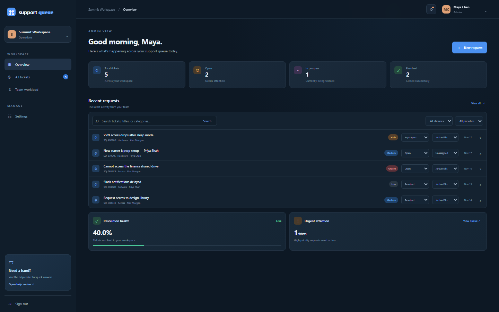
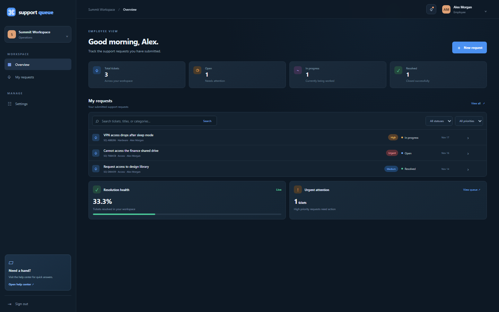
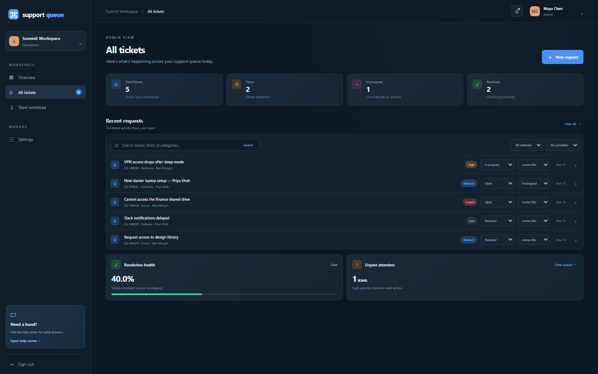
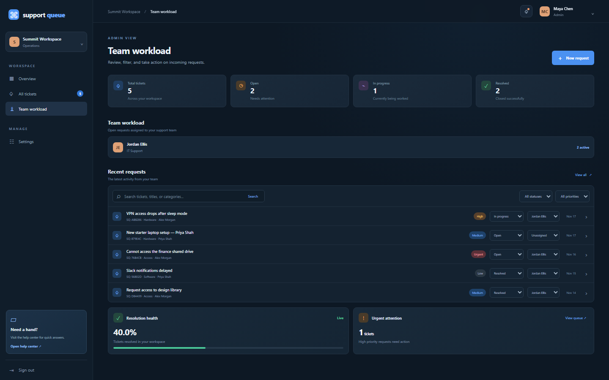
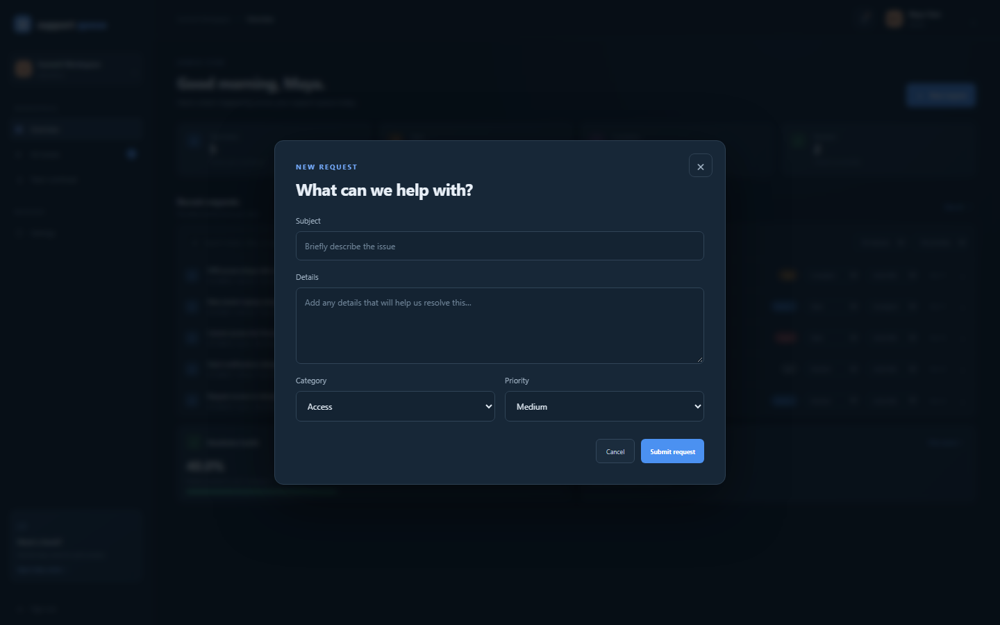
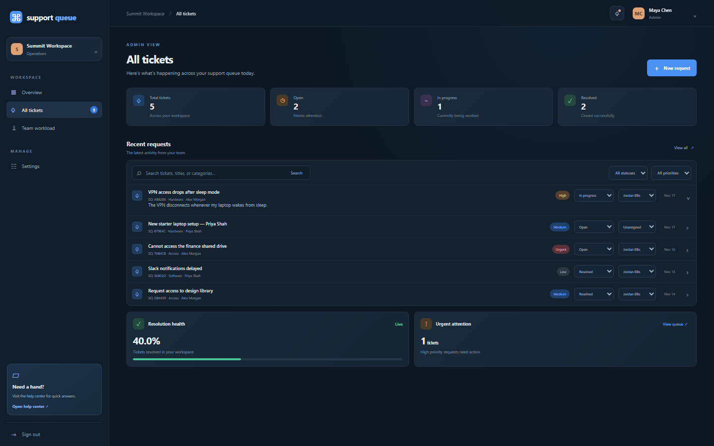
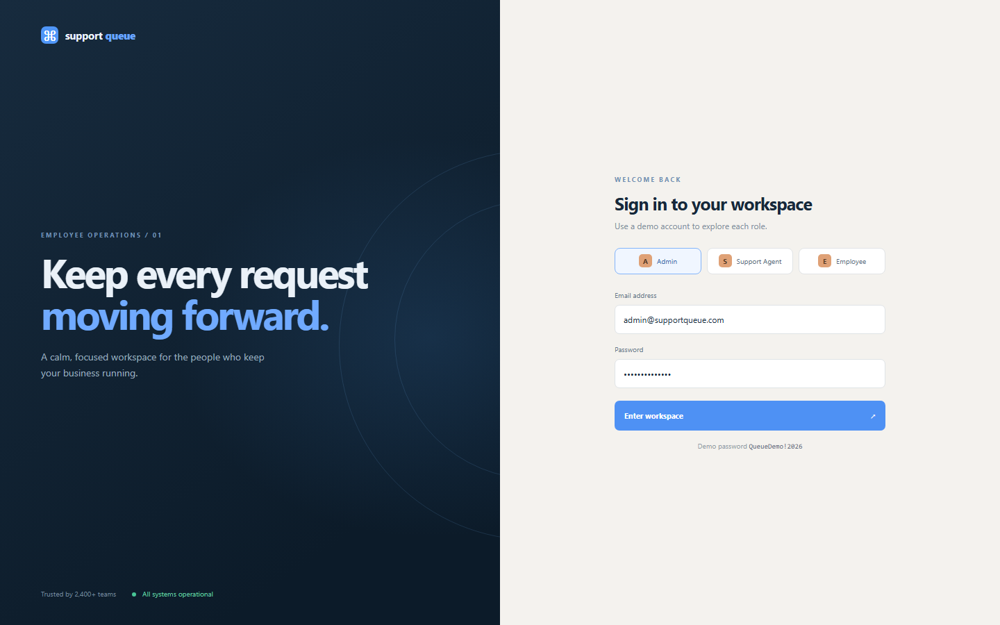

# Support Queue

### Employee Helpdesk & Ticket Management System

A full-stack helpdesk application for submitting employee support requests and managing them through resolution. Support Queue combines an Angular dashboard, an ASP.NET Core REST API, and SQL Server persistence, with JWT authentication and role-based access.


## Explore the application

The interface adapts to each role. Employees can follow their own requests; support agents and administrators can work across the team queue.

| Admin dashboard | Employee dashboard |
|---|---|
|  |  |

| Ticket queue and management | Team workload |
|---|---|
|  |  |

| Create a request | Ticket details |
|---|---|
|  |  |

| Sign in |
|---|
|  |

## What you can do

- Sign in as an **Admin**, **Support Agent**, or **Employee** using JWT authentication.
- Submit support requests with a subject, description, category, and priority.
- Search and filter tickets by status or priority.
- See live ticket totals, status counts, resolution health, and urgent requests.
- Assign requests to support agents and update their status.
- View a team workload summary and expand requests to read details.
- Browse a responsive dashboard designed for desktop and smaller screens.

### Role overview

| Role | Access |
|---|---|
| **Employee** | Submit requests and view or track their own tickets. |
| **Support Agent** | View the team queue, update ticket status, and assign requests. |
| **Admin** | View workspace-wide ticket and team information and manage the queue. |

## Technology and architecture

| Area | Technologies |
|---|---|
| Frontend | Angular 20, TypeScript, reactive forms, responsive CSS |
| API | ASP.NET Core 10 Web API, C# |
| Data access | Entity Framework Core, repository pattern, Dapper |
| Database | SQL Server, indexed tables, dashboard stored procedure |
| Security | JWT bearer authentication, role-based authorization, password hashing |

The backend separates responsibilities into four projects:

```text
Angular UI
    │ HTTP requests with JWT
    ▼
Helpdesk.Api ──► Helpdesk.Application ──► Helpdesk.Domain
                        │
                        ▼
              Helpdesk.Infrastructure
               EF Core / Dapper
                        │
                        ▼
                    SQL Server
```

The database contains normalized `Users` and `Tickets` tables. EF Core handles application persistence, while Dapper calls `dbo.GetTicketDashboardStats` for dashboard aggregates. On first API startup, the development bootstrap creates the database schema and seeds demo users and tickets if no users exist.

## Run locally (Windows)

### Prerequisites

- Windows with PowerShell
- [.NET 10 SDK](https://dotnet.microsoft.com/download/dotnet/10.0)
- [Node.js 20.19 or newer](https://nodejs.org/) and npm
- SQL Server Express (`SQLEXPRESS`) or another SQL Server instance

### 1. Start SQL Server

For the default configuration, ensure the SQL Server Express service is running:

```powershell
Get-Service 'MSSQL$SQLEXPRESS'
```

The default connection string targets `.\SQLEXPRESS` and creates a database named `SupportQueue` using Windows integrated authentication. The Windows account running the API must be allowed to create the database on first startup.

If you use another SQL Server instance, update `ConnectionStrings:Helpdesk` in `Backend\Helpdesk.Api\appsettings.json` before starting the API.

### 2. Start the API

From the project root, open a terminal and run:

```powershell
dotnet run --project Backend\Helpdesk.Api\Helpdesk.Api.csproj --urls http://localhost:5172
```

In Development, the API exposes its OpenAPI document at [http://localhost:5172/openapi/v1.json](http://localhost:5172/openapi/v1.json). A temporary JWT signing key is generated if one is not configured; tokens are invalidated when the API restarts.

### 3. Start Angular

In a second terminal at the project root:

```powershell
cd Frontend
npm install
npm start
```

Open [http://localhost:4200](http://localhost:4200). If port 4200 is already occupied, use:

```powershell
npm start -- --port 4201
```

Then open [http://localhost:4201](http://localhost:4201).

## Demo sign-in

Use the following seeded demo accounts to explore each role. **These credentials are for local demonstration only.**

| Role | Email |
|---|---|
| Admin | `admin@supportqueue.com` |
| Support Agent | `agent@supportqueue.com` |
| Employee | `employee@supportqueue.com` |
| Sample employee | `priya@supportqueue.com` |

**Demo password for all accounts:** `QueueDemo!2026`

## API overview

All ticket endpoints except login require a bearer token. Employees only see their own tickets and dashboard statistics.

| Method | Endpoint | Purpose |
|---|---|---|
| `POST` | `/api/auth/login` | Authenticate and receive a JWT. |
| `GET` | `/api/tickets` | List tickets; supports `search`, `status`, and `priority` query filters. |
| `GET` | `/api/tickets/{id}` | Get a ticket. |
| `GET` | `/api/tickets/stats` | Get dashboard aggregates. |
| `POST` | `/api/tickets` | Create a support request. |
| `PATCH` | `/api/tickets/{id}/status` | Update a ticket status (Admin or Support Agent). |
| `PATCH` | `/api/tickets/{id}/assignment` | Assign a ticket (Admin or Support Agent). |
| `GET` | `/api/team/agents` | List support agents for the workload view. |

## Project structure

```text
Backend/
  Helpdesk.Api/             ASP.NET Core controllers, JWT, and startup
  Helpdesk.Application/     Application services and contracts
  Helpdesk.Domain/          Ticket, user, role, status, and priority types
  Helpdesk.Infrastructure/  EF Core, repositories, Dapper, and database setup
Frontend/                   Angular standalone application
database/                   SQL Server dashboard stored procedure
screenshots/                README and project reference images
SupportQueue.slnx            .NET solution
```

## Build and test

From the project root, build the backend:

```powershell
dotnet build SupportQueue.slnx
```

Build the Angular application and run its tests:

```powershell
cd Frontend
npm run build
npm test -- --watch=false
```

## Notes before production use

- Demo users, sample tickets, and the demo password are for local development only.
- Configure a persistent, strong `Jwt__SigningKey` (at least 32 bytes), a production `ConnectionStrings__Helpdesk`, and the correct `Cors__AllowedOrigins__0` value for your deployment.
- The current database bootstrap uses EF Core `EnsureCreated`, which is intended for a fresh development database and does not evolve an existing schema. Use EF Core migrations and a reviewed deployment process for schema changes in an existing or production database.
- Do not use the generated development JWT key for a deployed environment.
